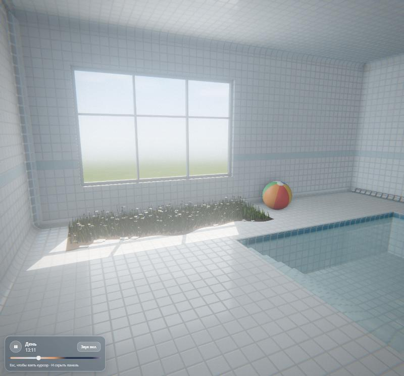
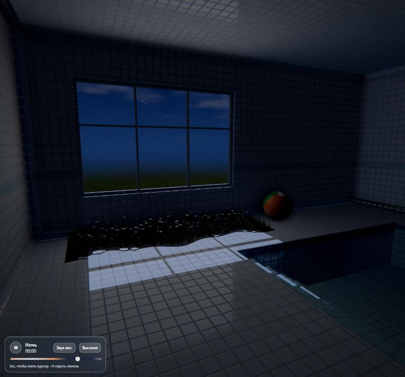
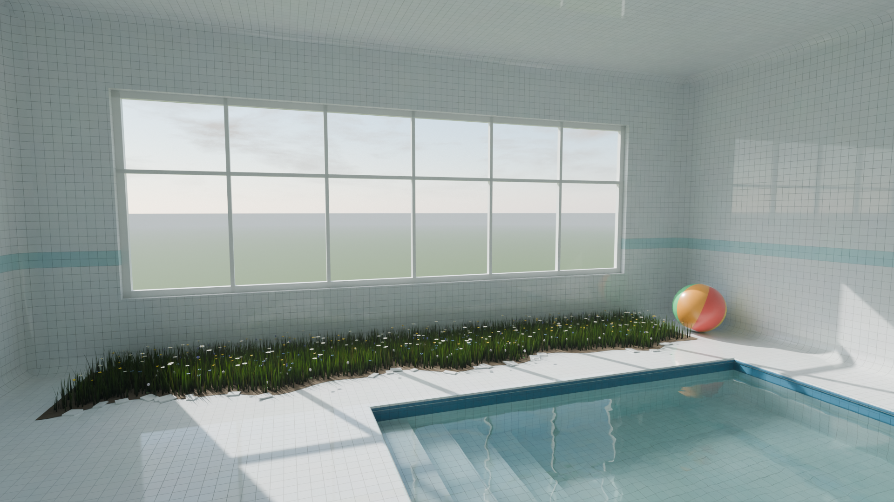

# Pool Room

Небольшая лиминальная комната в духе pool rooms: белый кафель, мелкий бассейн с прозрачной водой, большое окно и луговая трава с мелкими цветами, проросшая сквозь плитку под подоконником. Ламп нет, весь свет приходит из окна, а сутки проходят за две минуты.

**Открыть в браузере:** https://pitr-griffin.github.io/pool-room/




## Что внутри

- **Цикл суток за 2 минуты**: утро, день, вечер, ночь. Время можно остановить кнопкой на панели или клавишей P. За широким окном меняется небо (плывущие облака, закат, звёзды и луна), солнечный или лунный луч движется по полу и отбрасывает тень оконного переплёта.
- **Кафель**: плитка 15 см со скруглёнными краями, утопленными швами и глянцем. Стены плавно переходят в пол и потолок через скруглённые углы, как в настоящих бассейнах.
- **Свет из Blender**: геометрия комнаты и мягкий отражённый свет посчитаны в Cycles (path tracing) для утра, дня, вечера и ночи и плавно перетекают друг в друга по ходу суток. Солнечный луч, тени, объёмные лучи с пылинками и затенение в углах считаются в реальном времени.
- **Вода с физикой**: поверхность — волновое уравнение на видеокарте. Волны разбегаются от шагов, отражаются от стенок бассейна и гаснут; вода по-настоящему отражает комнату и преломляет дно, глубже — бирюзовее.
- **Каустика**: солнечный свет преломляется через смоделированные волны и рисует на дне живые светящиеся сетки — они зависят от того, как ты взбаламутил воду. Отблески от воды бегут и по потолку.
- **Брызги и мокрые следы**: при входе в воду летят капли, пол у бассейна мокрый и блестит, а после выхода из воды на кафеле остаются следы босых ног, которые высыхают.
- **Мелкий бассейн** по пояс: в воду ведут пологие кафельные ступени.
- **Луговая полоса** под окном: колышущаяся трава, ромашки, лютики, незабудки, клевер, колокольчики. Когда идёшь по траве, она приминается под ногами и медленно распрямляется.
- **Надувной мяч**: его можно толкать телом, пинать кликом, он плавает в бассейне.
- **Звук** генерируется прямо в браузере: тихий светлый эмбиент, шаги по кафелю с эхом, шорох травы, плеск, птицы днём и сверчки ночью.

## Управление

| Клавиша | Действие |
| --- | --- |
| WASD / стрелки | ходить |
| Shift | идти быстрее |
| Мышь | осмотреться |
| Клик | пнуть мяч |
| P | остановить / запустить время суток |
| H | скрыть панель |
| M | вкл./выкл. звук |
| Q | качество графики: высокое / быстрое (для слабых компьютеров) |
| Esc | вернуть курсор (чтобы двигать ползунок времени) |

Нужны клавиатура и мышь, на телефоне сцена не управляется.

## Фотореалистичная версия (Blender)

Та же комната собрана в Blender и отрендерена в Cycles: физически точный свет, преломление в воде, объёмные лучи из окна. Готовые кадры лежат в папке [`renders/`](renders/).



Пересобрать сцену и отрендерить кадр (нужен Blender 5.2+):

```bash
blender --background --factory-startup --python blender/pool_room.py -- --time day --camera Camera --samples 512 --res 1920x1080
```

Видео с бликами на воде — [`renders/pool_room_glint.mp4`](renders/pool_room_glint.mp4) (рендерит `--time glint --video 8`, склеивает `blender/encode_video.py`).

`--time`: `morning`, `day`, `evening`, `night`, `glint`. `--camera`: `Camera`, `CameraPool`, `CameraMeadow`. Скрипт также сохраняет `blender/pool_room.blend`, его можно открыть в Blender и крутить вручную. Все кадры сразу рендерит `blender/render_all.ps1`.

## Запуск локально

Сборка не нужна: это статическая страница на [three.js](https://threejs.org/), библиотека грузится с CDN. Достаточно отдать папку любым статическим сервером, например:

```bash
npx serve .
```

## Устройство

- `src/layout.js` — размеры комнаты, бассейна, окна и луговой полосы
- `src/daycycle.js` — цикл суток: цвета неба и света, положение солнца и луны
- `src/sky.js` — небо за окном
- `src/room.js` — комната из Blender (`assets/room.glb`), процедурный кафель, карты освещения, мокрые следы
- `src/water.js` — поверхность воды: отражение, преломление, поглощение
- `src/waterSim.js` — физика волн и каустика на видеокарте
- `blender/bake_web.py` — запекает отражённый свет комнаты для веб-версии (`assets/lightmap_*.exr`)
- `src/effects.js` — объёмный свет, пылинки, финальная цветокоррекция
- `src/meadow.js` — трава и цветы
- `src/ball.js` — мяч и его физика
- `src/player.js` — ходьба от первого лица
- `src/audio.js` — звук
- `GLOSSARY.md` — словарь понятий сцены
